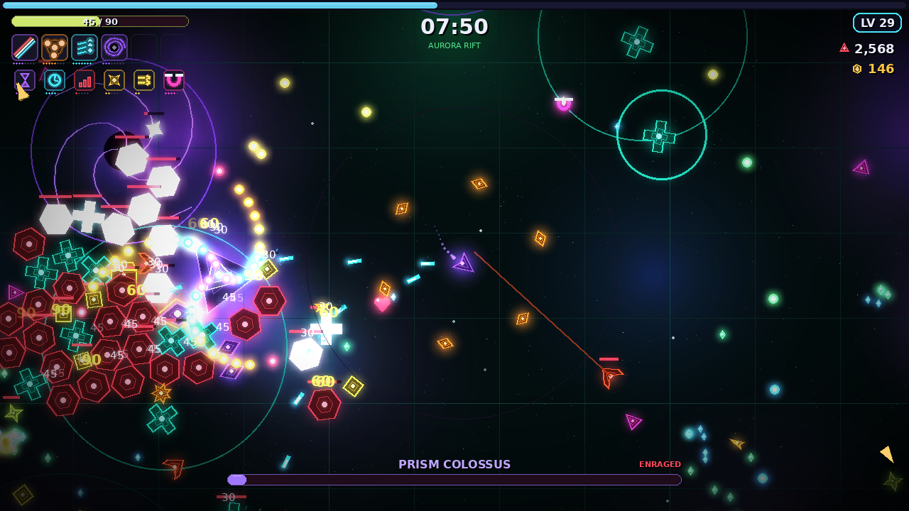
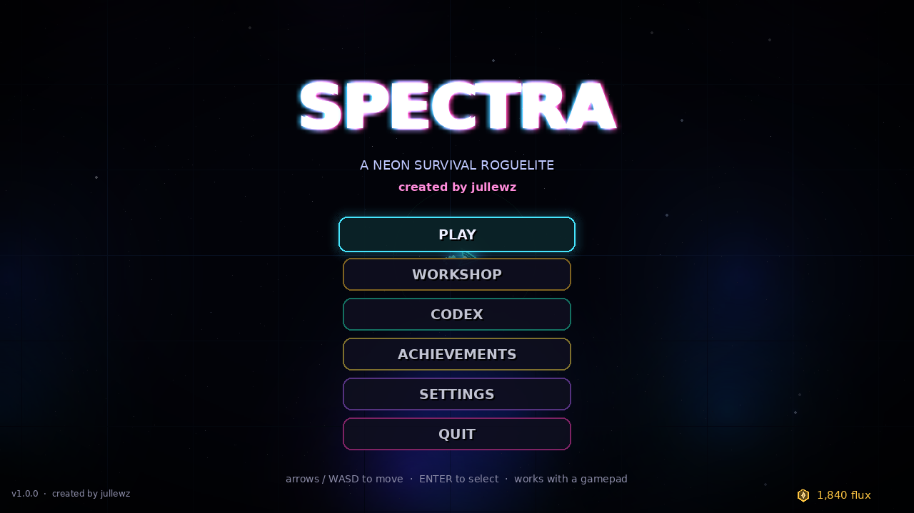
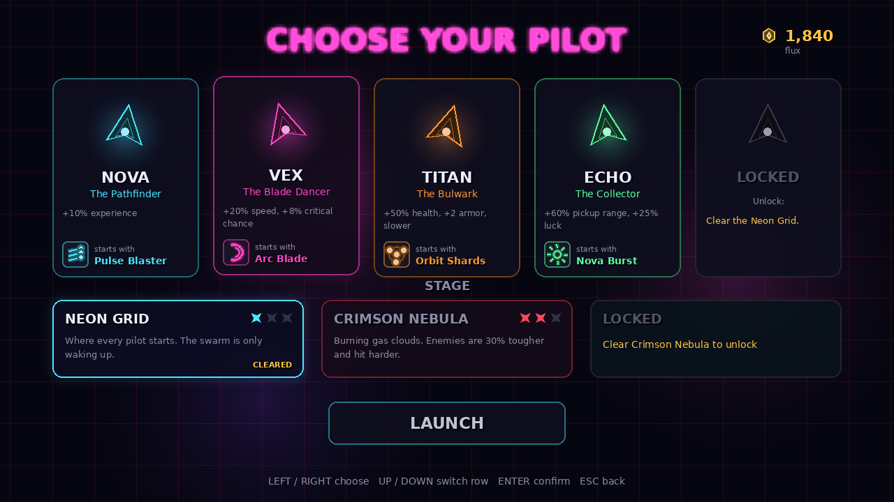
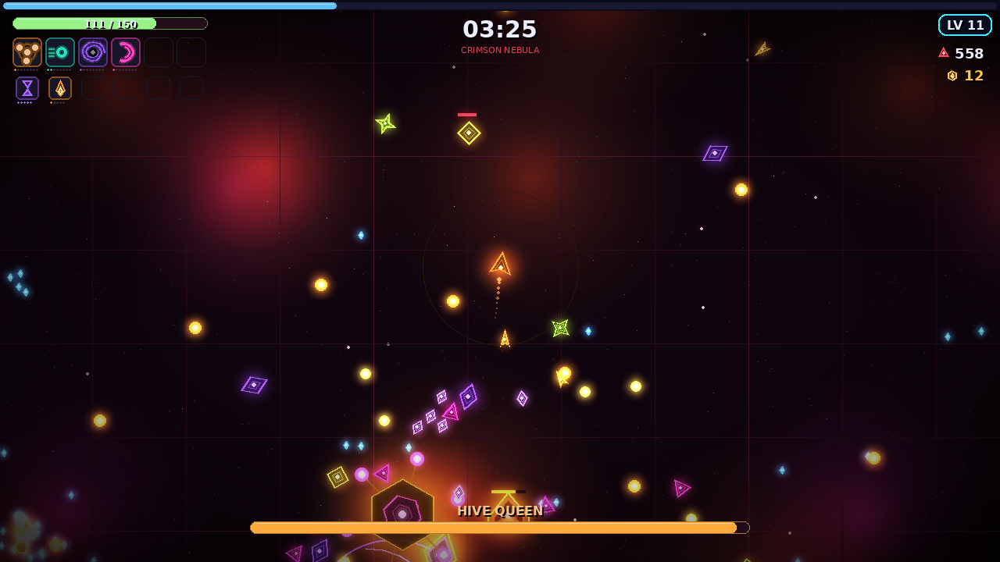
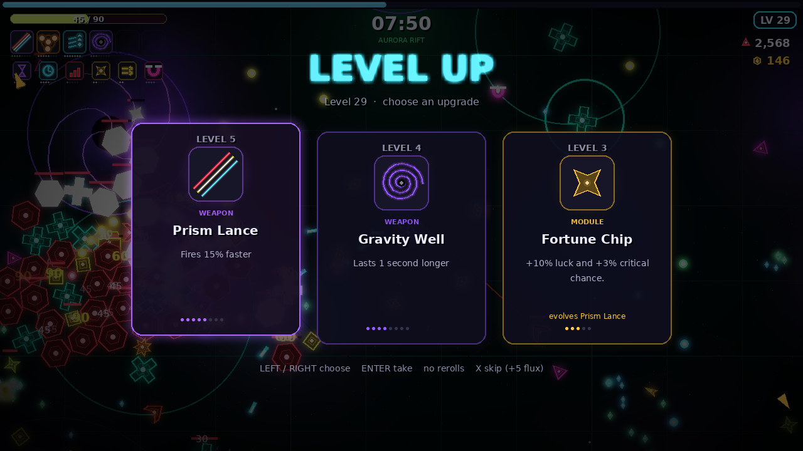
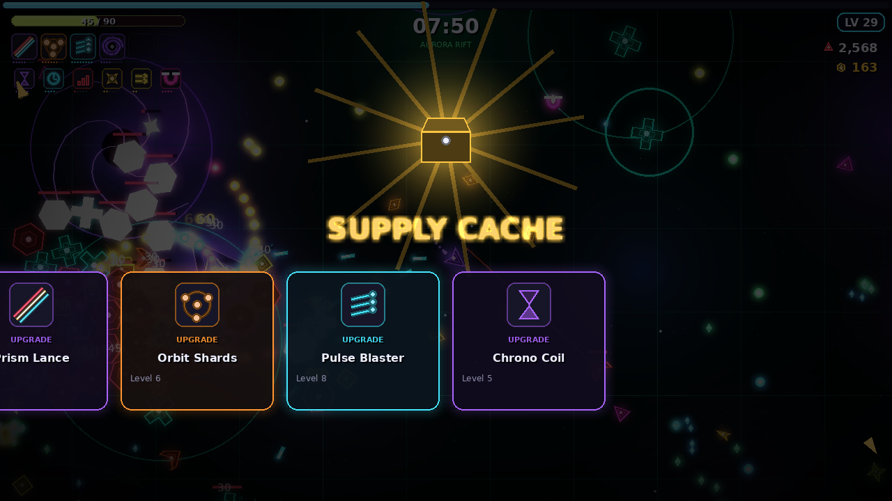
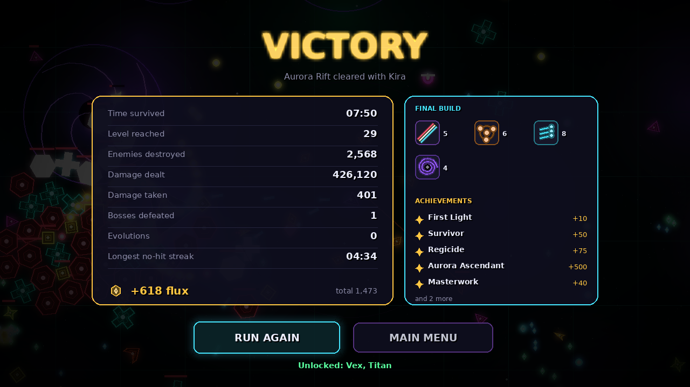
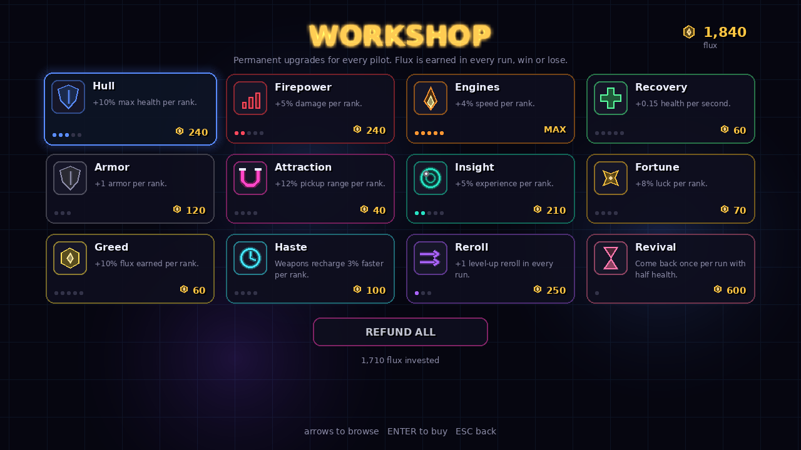
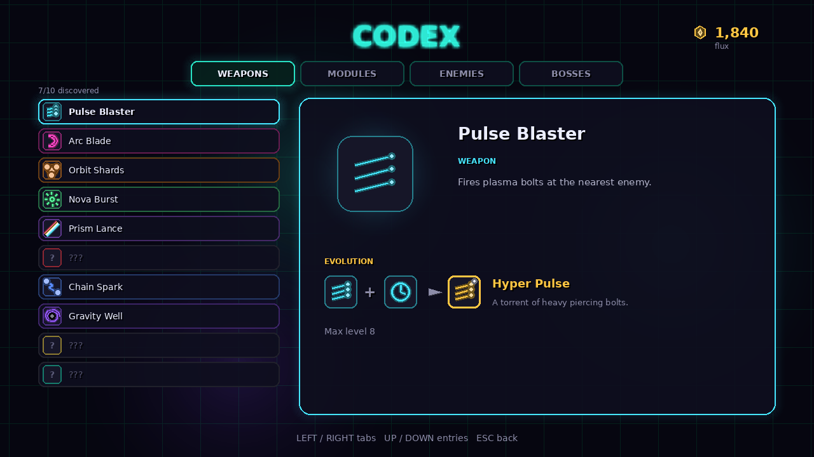

<div align="center">

# S P E C T R A

### A neon survival roguelite written in pure Python

**created by jullewz**




</div>

You are one small ship in an endless neon void. The swarm never stops coming.
Your weapons fire on their own: **you only steer.** Collect experience crystals, level up,
build a loadout of up to six weapons and six modules, fuse them into evolved super-weapons,
and survive **twelve minutes** and four bosses.

Every pixel and every sound in SPECTRA is generated by code at runtime. The repository
contains **zero image, font or audio files used by the game** (the PNGs in `assets/` are only
screenshots for this page). The ships, enemies, icons, glow, bloom, starfields and nebulae are
drawn procedurally, and the sound effects and both music tracks are synthesized from sine,
square and noise waves when the game starts.

---

## Features

- **10 weapons, each with 8 levels and an evolution.** Pulse Blaster, Arc Blade, Orbit Shards,
  Nova Burst, Prism Lance, Seeker Swarm, Chain Spark, Gravity Well, Mine Layer and Halo Disc.
  Max a weapon, own its partner module, open a chest, and it evolves (Hyper Pulse, Black Hole,
  Storm Lattice, Supernova, Event Horizon...).
- **11 passive modules** that change your stats: cooldown, damage, area, speed, armor,
  pickup range, extra projectiles, duration, regeneration, luck and projectile speed.
- **11 enemy types** with their own behaviors: chasers, weavers, chargers, ranged spitters,
  bombers that explode, splitters that burst into shards, wardens that heal the swarm,
  plus glowing elite variants.
- **4 bosses** with multiple attack phases: the Hive Queen, the Prism Colossus with its
  rotating lasers, the 16-segment Serpent, and the Singularity that pulls you in.
- **A scripted 12-minute run**: swarms, encirclements, elite waves and boss fights that ramp
  up over time, directed by a spawn director.
- **5 pilots** with different stats and starting weapons, and **3 stages** with rising difficulty.
- **Meta progression**: earn flux in every run and spend it in the Workshop on 12 permanent
  upgrades. 20 achievements unlock new pilots. A Codex logs every weapon, module, enemy and
  boss you have discovered.
- **Juice**: bloom, additive glow, screen shake, hit flashes, damage numbers, particles,
  chromatic title, vignette, and 60 FPS action with hundreds of enemies on screen.
- **Built-in AI pilot**: the title screen plays a real game in the background, and
  `--autoplay` lets the bot play your runs.
- **Keyboard, mouse and gamepad** support. Fullscreen with clean scaling. Settings and
  progress are saved automatically.

## Screenshots

| | |
|:---:|:---:|
|  |  |
| Title screen, with a live AI game behind the menu | Choose your pilot and stage |
|  |  |
| The Hive Queen on the Crimson Nebula | Level up: pick one of three or four upgrades |
|  |  |
| Chests hold upgrades, flux and evolutions | Results and unlocked achievements |
|  |  |
| Spend flux on permanent upgrades | The Codex shows everything you have found |

## Install and play

You need **Python 3.8 or newer**.

```bash
git clone https://github.com/jullewz/SPECTRA.git
cd SPECTRA
pip install -r requirements.txt
python run.py
```

`requirements.txt` installs **pygame-ce**. Classic `pygame` 2.1 or newer works too.
You can also start the game with `python -m spectra`.

## Controls

| Action | Keyboard | Gamepad |
|---|---|---|
| Move | WASD or arrow keys | Left stick |
| Confirm | Enter or Space | A |
| Back / pause | Esc or P | B / Start |
| Reroll level-up cards | R | X |
| Skip a level-up (+5 flux) | X | Y |
| Fullscreen | F11 | |
| FPS counter | F3 | |
| Screenshot | F12 | |

The mouse works in every menu.

## How a run works

1. Enemies drop **experience crystals**. Pick them up to fill the bar at the top and level up.
2. Every level offers 3 cards (sometimes 4 if you are lucky): a new weapon, a weapon level,
   or a module. You can hold 6 weapons and 6 modules.
3. Elites and bosses drop **chests**. A chest upgrades your build, or evolves a weapon if one
   is ready.
4. Bosses arrive at 3:00, 6:00 and 9:00. At 12:00 the Singularity appears. Destroy it to win.
5. Win or lose, you earn **flux** for the Workshop.

**Evolution recipe:** a weapon at max level + its partner module + a chest. The Codex shows every
recipe you have discovered.

## Command line

```text
python run.py [options]

  --fullscreen / --windowed   choose the display mode
  --mute                      no sound
  --autoplay                  the built-in AI pilot plays for you
  --scene NAME                open a screen directly: title, select, game, workshop,
                              codex, achievements, settings
  --char ID --stage ID        pilot and stage for --scene game
  --seed N                    fixed random seed for a reproducible run
  --save PATH                 use a different save file
  --seconds N                 quit after N seconds
  --shots DIR                 write a screenshot every --shot-every seconds
  --headless                  no window and no audio (testing)
  --bench                     print frame-time statistics on exit
```

Example: watch the AI play the hardest stage with Kira:

```bash
python run.py --scene game --char kira --stage aurora --autoplay
```

## Project layout

```text
SPECTRA/
├── run.py                  start the game
├── requirements.txt
├── spectra/
│   ├── app.py              window, main loop, scene stack, command line
│   ├── config.py           screen size, palette and tuning constants
│   ├── world.py            the simulation: spawning, damage, pickups, drawing order
│   ├── entities.py         player, enemies, projectiles, hazards, pickups
│   ├── weapons.py          10 weapons with levels and evolutions
│   ├── bosses.py           4 multi-phase bosses
│   ├── director.py         the spawn director and the 12-minute event script
│   ├── upgrades.py         level-up cards, chests and evolutions
│   ├── bot.py              the AI pilot (potential-field steering)
│   ├── data.py             pilots, stages, modules, workshop upgrades, achievements
│   ├── save.py             save file, statistics and achievement rules
│   ├── assets.py           procedural sprites, glow, icons and text
│   ├── fx.py               camera, particles, background, bloom and post effects
│   ├── audio.py            synthesized sound effects and music
│   ├── inputs.py           keyboard, mouse and gamepad mapping
│   ├── ui.py               panels, bars, buttons and menus
│   └── scenes/             title, pilot select, game + HUD, workshop, codex,
│                           achievements, settings
├── tests/test_spectra.py   unit and simulation tests
└── assets/                 screenshots for this README
```

### Under the hood

- **Spatial hashing** keeps collision checks fast with 300+ enemies, hundreds of
  projectiles and hundreds of crystals on screen.
- **Cached vector sprites**: every polygon shape is pre-rendered per color and per rotation
  step, so drawing a ship costs one blit.
- **Cheap bloom**: the frame is downscaled, thresholded, scaled back up and added on top.
- **Synthesized audio**: waveforms are built sample by sample, packed into in-memory WAV
  files, and the music is composed on a background thread and cached on disk.
- **Deterministic runs**: the whole simulation uses a seeded random generator, which the
  tests rely on.

## Tests

```bash
python -m unittest discover tests
```

The suite checks the data tables, save files, the upgrade system, every weapon and its
evolution, every boss, every enemy, every screen, and lets the AI pilot play every pilot and
stage. Set `SPECTRA_LONG=1` to also simulate a full 12-minute run.

## Save files

Progress and settings live in:

- Windows: `%APPDATA%\SPECTRA\save.json`
- macOS: `~/Library/Application Support/SPECTRA/save.json`
- Linux: `~/.local/share/spectra/save.json`

Set the `SPECTRA_HOME` environment variable to use a different folder.

## License

MIT, see [LICENSE](LICENSE).

<div align="center">

**SPECTRA - created by jullewz**

</div>
